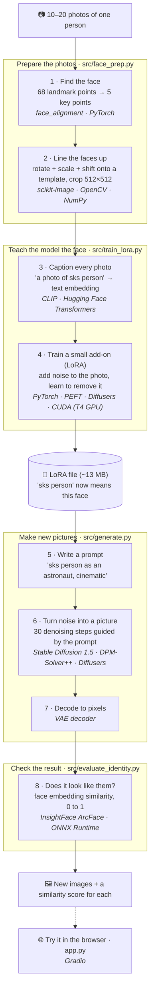

# Face Prompt Studio

**Show it 10–20 photos of a face, then type "sks person as an astronaut" and get pictures of that person as an astronaut.**

I built this after reading [Face2Diffusion](https://github.com/mapooon/Face2Diffusion), a CVPR 2024 paper that puts a person's face into AI-generated images. I wanted to understand every step myself, so I rebuilt the idea from scratch with a different (and simpler) training method, and added a way to *measure* whether the generated face still looks like the real person.

[](https://colab.research.google.com/github/Avani19051/face-prompt-studio/blob/main/notebooks/face_prompt_studio_colab.ipynb)

---

## The idea in one paragraph

Stable Diffusion already knows how to draw "a person". It just doesn't know *your* face. So we take a handful of your photos, line them all up so the eyes and mouth sit in the same place, and give each one the caption *"a photo of sks person"*. Then we train a tiny add-on to the model (a **LoRA**) until "sks person" means *you*. After that, any prompt with "sks person" in it draws your face, in any scene or art style you describe. Finally, a face-recognition model checks each result and gives it a similarity score, so "does it look like me?" becomes a number instead of a guess.

---

## How it works: the flowchart



### Tech used at each step

| Step | What happens | Tech |
|---|---|---|
| 1. Find the face | Locates 68 points on the face (eyes, nose, mouth, jaw) | `face_alignment`, PyTorch |
| 2. Line the faces up | Rotates, scales and crops every photo the same way | scikit-image, OpenCV, NumPy, Pillow |
| 3. Caption | Turns "a photo of sks person" into numbers the model understands | CLIP text encoder (Hugging Face Transformers) |
| 4. Train the LoRA | Teaches the model the face with a small add-on | PyTorch, PEFT (LoRA), Diffusers, CUDA mixed precision |
| 5. Prompt | You describe the scene you want | Plain text |
| 6. Generate | Starts from random noise and cleans it up step by step | Stable Diffusion 1.5 U-Net, DPM-Solver++ scheduler |
| 7. Decode | Turns the model's compressed image into real pixels | Stable Diffusion VAE |
| 8. Check | Scores how similar each new face is to the real photos | InsightFace (ArcFace), ONNX Runtime |
| Demo | A small web page to type prompts and see results | Gradio |
| Tests | Check the maths and run the whole pipeline on a tiny model | pytest |

---

## Each step, explained like I'd explain it to a friend

### 1 · Find the face (`face_prep.py`)
Your photos are all different: some close-up, some far away, some tilted. First we find the face and mark 68 points on it: the outline of the jaw, eyebrows, eyes, nose and lips. We only need 5 of them, so we average the 6 points around each eye to get the eye centre, and keep the nose tip and the two mouth corners. If there's more than one face in a photo, we keep the biggest.

```python
eye_a = lmk68[36:42].mean(axis=0)   # centre of one eye
eye_b = lmk68[42:48].mean(axis=0)   # centre of the other
nose, mouth_a, mouth_b = lmk68[30], lmk68[48], lmk68[54]
```

### 2 · Line the faces up (`face_prep.py`)
Now we move every photo so those 5 points land in exactly the same spots. That's one rotation, one zoom and one shift (a "similarity transform"), so faces never get stretched or squashed. The target spots are the standard layout face-recognition models use, scaled up to 512×512 with some margin so hair and shoulders stay in the picture.

**Why bother?** If the eyes are always in the same place, the model can spend its effort learning *who* this is instead of *where the face is*. The tests check that this step exactly undoes a tilted, shrunk and shifted face.

### 3 · Caption every photo (`train_lora.py`)
Every photo gets the same caption: **"a photo of sks person"**. "sks" is a made-up word the model has basically never seen, so it's a blank label we can attach your face to. "person" keeps everything the model already knows about people. CLIP (the text half of Stable Diffusion) turns that sentence into numbers. Since the caption never changes, we do this once, not on every step.

### 4 · Train a small add-on, the LoRA (`train_lora.py`)
This is the heart of it. Stable Diffusion learns to draw by learning to *remove noise*, so training repeats a simple loop:

1. Shrink a photo into the model's compressed "latent" form (the VAE does this).
2. Add a random amount of random noise to it.
3. Ask the model to guess exactly which noise was added, given the caption "a photo of sks person".
4. Compare the guess with the real noise and nudge the model to guess better.

```python
noisy = scheduler.add_noise(latents, noise, t)          # step 2
pred  = unet(noisy, t, encoder_hidden_states=caption)   # step 3
loss  = F.mse_loss(pred, noise)                         # step 4
```

The trick: we **don't** change the big model (860 million numbers). We freeze it and add small LoRA layers inside its attention blocks, the parts that connect words to image regions. Only those 3.2 million numbers (about 0.4%) are trained. That's why it fits on a free Colab GPU and the result is a ~13 MB file instead of a 4 GB one.

I wrote this training loop by hand instead of using a ready-made trainer so every step is visible. It runs in half precision (fp16) on the GPU to save memory, and saves a preview every 200 steps so you can literally watch the face appear.

### 5 · Write a prompt
Anything you like, as long as it contains **"sks person"**: *"sks person as a renaissance painting"*, *"sks person reading in a cafe, 35mm film"*. "sks person" says *who*; the rest says *where* and *in what style*.

### 6 · Turn noise into a picture (`generate.py`)
We load normal Stable Diffusion, plug in your LoRA, and start from pure random noise. Over 30 steps the model removes a bit of noise at a time, steering towards your prompt. A "negative prompt" steers it *away* from things like blurry or deformed faces. You can turn the LoRA's strength up or down with `--lora_scale`.

### 7 · Decode to pixels (`generate.py`)
The model works in a compressed space, so the last step is the VAE decoder turning that compressed image back into a normal 512×512 picture.

### 8 · Does it look like them? (`evaluate_identity.py`)
"Looks like me" is subjective, so we measure it. ArcFace is a face-recognition network that turns any face into 512 numbers, where photos of the same person end up close together. We average the numbers for your real photos, do the same for each generated image, and compare them (cosine similarity):

- **above 0.5**: very likely the same person
- **0.3–0.5**: resemblance
- **below 0.2**: a different person

We also generate the same prompts *without* the LoRA. The gap between the two scores shows how much the training actually added.

---

## Try it

### Easiest: Google Colab (free GPU)
1. Click the **Open in Colab** badge above.
2. **Runtime → Change runtime type → T4 GPU → Save.**
3. **Runtime → Run all**, and upload 10–20 photos when asked.

About 30 minutes in total. Free GPUs aren't always available at busy times; if Colab says none are free, try again later or use Kaggle.

### Kaggle (free, about 30 GPU hours a week)
Upload your photos as a private Kaggle dataset, create a notebook, turn on **Settings → Accelerator → GPU T4** and **Internet**, then run:

```bash
!git clone -q https://github.com/Avani19051/face-prompt-studio.git && cd face-prompt-studio && pip -q install -r requirements.txt
!cd face-prompt-studio && python src/face_prep.py --input /kaggle/input/<your-dataset> --output data/aligned \
    && python src/train_lora.py --instance_dir data/aligned --output_dir outputs/lora \
    && python src/generate.py --lora_dir outputs/lora -p "a portrait of sks person as an astronaut" -n 4
```

### On your own machine (NVIDIA GPU)
```bash
pip install -r requirements.txt
python src/face_prep.py --input data/raw --output data/aligned                  # steps 1–2
python src/train_lora.py --instance_dir data/aligned --output_dir outputs/lora  # steps 3–4
python src/generate.py --lora_dir outputs/lora -p "sks person as an astronaut, cinematic" -n 4   # steps 5–7
python src/evaluate_identity.py --reference_dir data/aligned --generated_dir outputs/generated  # step 8
python app.py --lora_dir outputs/lora --reference_dir data/aligned --share     # web demo
```

**Photo tips:** different angles, expressions, lighting and backgrounds; one person per photo; no sunglasses. Variety matters more than quantity.

### Tests (no GPU needed)
```bash
pytest -q tests
```
These check the alignment maths and run the whole train → save → load → generate loop on a tiny Stable Diffusion with random weights. They prove the code runs; they can't tell you how good the faces look. That needs the real model on a GPU.

---

## What's in the repo

```
face-prompt-studio/
├── src/
│   ├── face_prep.py          # steps 1–2: find the face, line it up, crop
│   ├── train_lora.py         # steps 3–4: caption + the training loop
│   ├── generate.py           # steps 5–7: prompt → picture
│   └── evaluate_identity.py  # step 8: similarity scores
├── app.py                    # Gradio web demo
├── notebooks/face_prompt_studio_colab.ipynb
├── tests/                    # maths tests + a tiny end-to-end run
└── requirements.txt
```

---

## How this differs from Face2Diffusion

Face2Diffusion is cleverer in one big way: it needs **one** photo and **no training per person**. It trains a face encoder once on a huge dataset, then converts any face directly into two "words" it slips into the prompt. My version takes the simpler route: fine-tune a small LoRA on 10–20 photos of each person.

| | Face2Diffusion | Face Prompt Studio |
|---|---|---|
| Photos needed | 1 | 10–20 |
| Training per person | none | ~20 min LoRA |
| Where the face goes in | the prompt (two invented words) | the model's attention layers (LoRA) |
| Face preparation | 68 → 5 points, align to a template | same idea, rewritten, bigger crops |
| Measuring results | paper benchmarks | ArcFace score per image + a no-LoRA baseline |

The face-alignment idea is the standard one from face recognition, which Face2Diffusion also uses. All the code here is my own; none is copied from Face2Diffusion (which is licensed CC BY-NC-SA 4.0).

## Please use it responsibly

Only use photos of yourself or of people who have said yes. Don't use it to impersonate anyone or to make misleading or intimate images of real people.

## Thanks to

- [Face2Diffusion](https://github.com/mapooon/Face2Diffusion) for the idea and the alignment approach
- [DreamBooth](https://dreambooth.github.io/) for the rare-word ("sks") trick
- [LoRA](https://arxiv.org/abs/2106.09685), Hugging Face [Diffusers](https://github.com/huggingface/diffusers) and [PEFT](https://github.com/huggingface/peft)
- [face_alignment](https://github.com/1adrianb/face-alignment) and [InsightFace](https://github.com/deepinsight/insightface)

## License

MIT for this code. Stable Diffusion weights have their own CreativeML OpenRAIL-M license, and InsightFace's pre-trained models are for non-commercial research use.
